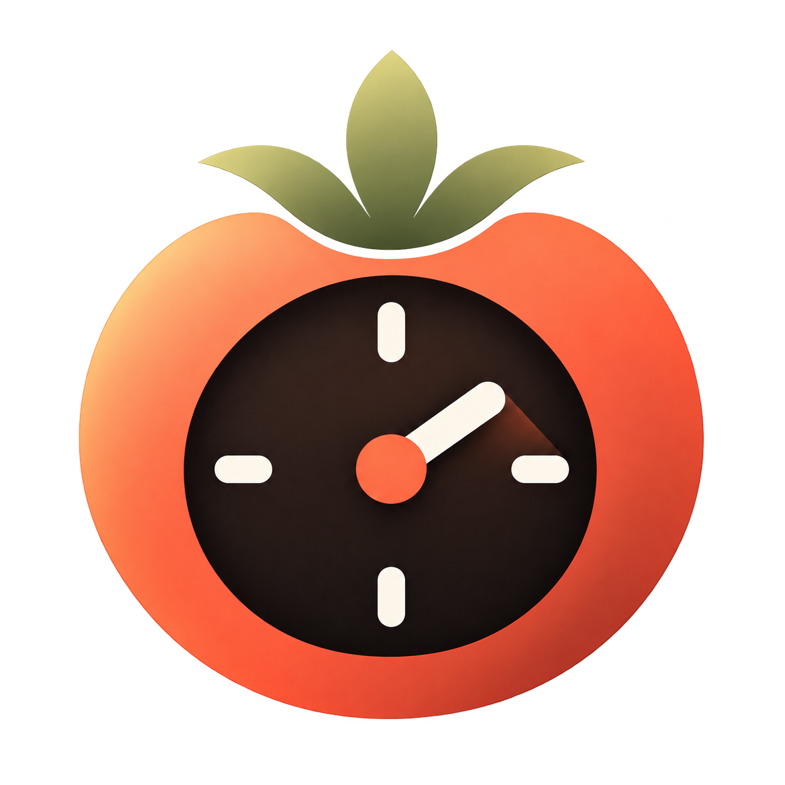

<a id="readme-top"></a>

<div align="center">
  <h1>🍅 Pomodoro Timer</h1>
  <p>
    A private, browser-first focus timer for turning large tasks into manageable work sessions.
    <br />
    <a href="https://pomodoro-pi-woad.vercel.app/">Open the live app</a>
    ·
    <a href="https://github.com/zetachess/Pomodoro/issues">Report a problem</a>
    ·
    <a href="https://github.com/zetachess/Pomodoro/issues">Request an improvement</a>
  </p>

  <p>
    <a href="https://github.com/zetachess/Pomodoro/blob/main/LICENSE"></a>
    <a href="https://vite.dev/"></a>
    <a href="https://www.typescriptlang.org/"></a>
    <a href="https://github.com/zetachess/Pomodoro/blob/main/SECURITY.md"></a>
  </p>
</div>



## Table of Contents

- [About the Project](#about-the-project)
- [Features](#features)
- [Getting Started](#getting-started)
- [How Data Is Stored](#how-data-is-stored)
- [Architecture](#architecture)
- [Checks](#checks)
- [Contributing](#contributing)
- [Security and Privacy](#security-and-privacy)
- [License](#license)

## About the Project

Pomodoro Timer is a lightweight focus app for breaking work into focused intervals and deliberate breaks. It runs in the browser without accounts, a backend, or analytics.

Tasks, sessions, preferences, streaks, and achievements stay on the device through browser `localStorage`. The app is designed for people who want a practical timer without creating another account or sending their routine to a server.

<p align="right">(<a href="#readme-top">back to top</a>)</p>

## Features

- Configurable focus sessions with short and long breaks.
- Task list with editing, completion, and timer linking.
- Session history, focus streaks, weekly insights, and achievements.
- Daily summary that can be copied or shared through WhatsApp by explicit user action.
- Optional browser notifications and sound alerts.
- Responsive layout for mobile, tablet, and desktop.
- Spanish interface.
- No built-in accounts, backend, or product analytics.

<p align="right">(<a href="#readme-top">back to top</a>)</p>

## Getting Started

### Prerequisites

- Node.js 20 or newer.
- npm 10 or newer.

### Installation

```bash
git clone https://github.com/zetachess/Pomodoro.git
cd Pomodoro
npm install
npm run dev
```

Open the local URL printed by Vite, usually [http://localhost:5173](http://localhost:5173).

<p align="right">(<a href="#readme-top">back to top</a>)</p>

## How Data Is Stored

The app stores its state locally under these browser keys:

- `pomogoblin-settings`
- `pomogoblin-tasks`
- `pomogoblin-sessions`
- `pomogoblin-timer`
- `pomogoblin-active-task`

You can remove all saved data from **Settings → Delete local data**. The app does not send routine timer, task, or session data to a server.

Browser storage can be read or modified by code running on the same origin. Do not store passwords, access tokens, or other sensitive information in the app.

<p align="right">(<a href="#readme-top">back to top</a>)</p>

## Architecture

```text
src/
├── App.tsx                 # Main views and application flow
├── types/                  # Domain types and default values
├── hooks/                  # Reusable React persistence hooks
└── utils/
    ├── pomodoro.ts         # Timer calculations and formatting
    └── storage.ts          # Storage keys and persisted-data validation
```

This is a React + TypeScript single-page application built with Vite. It does not make network requests during normal timer use. WhatsApp sharing, notifications, and sound alerts are triggered only by explicit user actions.

<p align="right">(<a href="#readme-top">back to top</a>)</p>

## Checks

Run the checks before opening a pull request or publishing a build:

```bash
npm run lint
npm run build
```

The production build is written to `dist/` and can be served as a static website.

<p align="right">(<a href="#readme-top">back to top</a>)</p>

## Contributing

Contributions, bug reports, accessibility improvements, translations, and focused product changes are welcome.

1. Create a descriptive branch.
2. Keep product and privacy decisions explicit.
3. Avoid adding telemetry or dependencies without explaining their impact.
4. Run `npm run lint` and `npm run build`.
5. Include desktop and mobile screenshots for visual changes.

<p align="right">(<a href="#readme-top">back to top</a>)</p>

## Security and Privacy

Read [SECURITY.md](SECURITY.md) before reporting a security issue. Please do not include private browser data, credentials, tokens, or personal information in an issue.

<p align="right">(<a href="#readme-top">back to top</a>)</p>

## License

Pomodoro Timer is released under the MIT License. See [LICENSE](LICENSE).

<p align="right">(<a href="#readme-top">back to top</a>)</p>